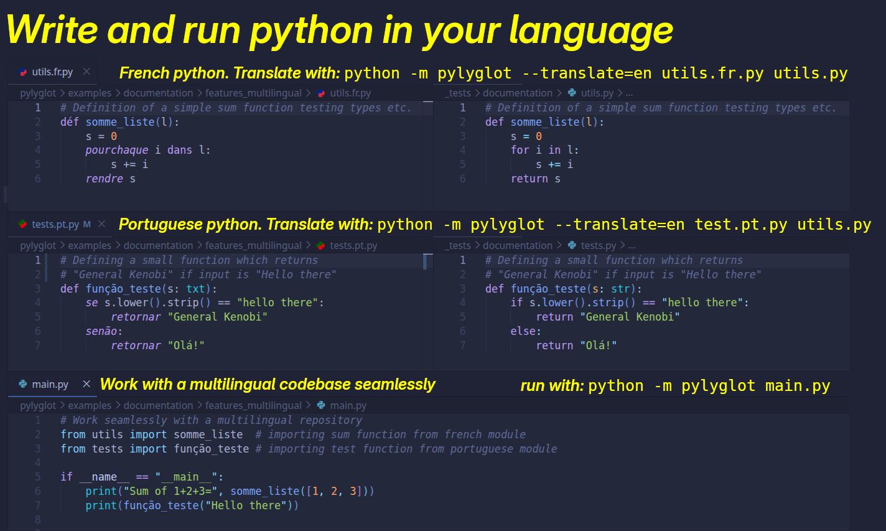

# Pylyglot: write and run python code on your native language



[> Documentation <](https://antoniorochaaz.github.io/pylyglot/)

How come it's 2026 and I can't write code in my own language,
with accents and special characters?

Pylyglot is an extremely simple python package with no dependencies
(other than python itself) which allow you to write "python" code
with keywords from your language. It can be used for teaching,
learning, in serious projects or for fun. Running it is as simple as running: 

``python -m pylyglot your_pylyglot_file``

Pylyglot also handles importing modules from different languages gracefully,
allowing for multilingual projects. 

With the [Pylyglot VSCode extension](https://marketplace.visualstudio.com/items?itemName=AntonioRochaAZ.pylyglot), syntax highlighting is also available for all
supported languages. The language is automatically recognized by the file extension: ``.language_code.py`` (e.g. portuguese_module **.pt.py**).

## Links

- [Pylyglot GitHub](https://github.com/AntonioRochaAZ/pylyglot)
- [Pylyglot documentation](https://antoniorochaaz.github.io/pylyglot/)
- [VSCode extension (marketplace)](https://marketplace.visualstudio.com/items?itemName=AntonioRochaAZ.pylyglot)
- [VSCode extension (source)](https://github.com/AntonioRochaAZ/pylyglot_vscode_extension)

## Main features

## Installation

### pip

Pylyglot is not (yet) at PyPI (unfortunately, the name is taken
and a new one will have to be devised), but will be soon. However, it is already available from Test PyPI 
(the sandboxed version of PyPI which is used for testing) and can be installed with:

``pip install -i https://test.pypi.org/simple/ pylyglot``

### From source
```
git clone https://github.com/AntonioRochaAZ/pylyglot.git
cd pylyglot
pip install .
```

# Documentation

[Check all features and the full documentation here!](https://antoniorochaaz.github.io/pylyglot/)

