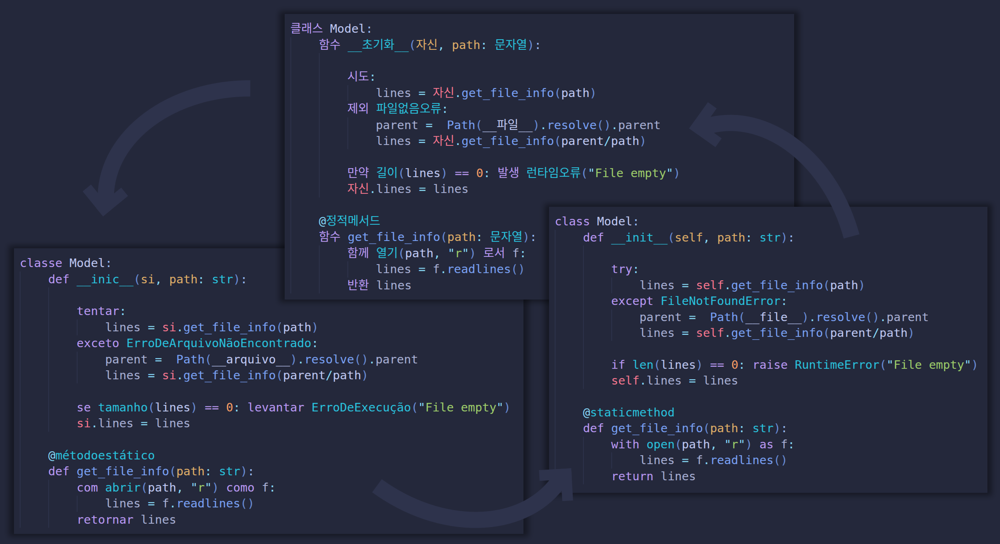
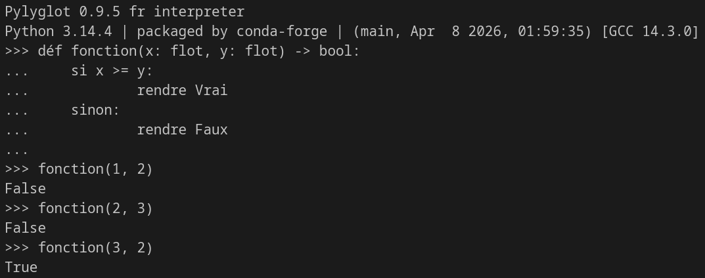

Features
========

Here are pylyglot's features at a glance !

- :ref:`feat-language_extensions`
- :ref:`feat-running`
- :ref:`feat-codebase`
- :ref:`feat-translating`
- :ref:`feat-console`
- :ref:`feat-traceback`
- :ref:`feat-internal_messages`
- :ref:`feat-smart_translation`
- :ref:`feat-security`

.. _feat-language_extensions:

Language extensions
-------------------

Languages are recognized through the file extension:

.. code-block:: text

    multilingual_codebase/
    ├── main.py         # .py --> Regular python
    ├── tests.pt_br.py  # .pt_br.py --> Brazilian portuguese python
    └── utils.fr.py     # .fr.pt --> French python 

.. seealso::
    :ref:`Check the supported languages and their codes in this section! <available_languages>`

Languages can also be identified through a comment at the first line 
of the file (indicating the language code and eventually the pylyglot
version, when the file file was through translation of an existing file):

.. code-block:: python
    
    # pylyglot: language_code # version: 0.5.0 #

You can still have ``#!/bin/bash`` type comments in the
first line of your module, and have the pylyglot comment as the second line!

.. note::
    The comment on the first line of code takes precedence over the
    file extension.

.. note::
    If there are two files with the same name but different extensions
    in the directory (e.g. main.py and main.fr.py), an ``ImportError``
    is triggered.

.. _feat-running:

Running pylyglot files directly
-------------------------------

By running ``python -m pylyglot your_pylyglot_file``, you can run your
pylyglot code directly, without having to translate it to regular python.

.. _feat-codebase:

Running a multilingual code base seamlessly
-------------------------------------------

Say you have for example:

.. code-block:: text

    multilingual_codebase/
    ├── main.py         # main code (traditional python)
    ├── tests.pt.py     # tests (in portuguese)
    └── utils.fr.py     # utils (in french)

With ``main.py``:

.. code-block:: python

    from utils import somme_liste  # importing sum function from french module
    from tests import função_teste # importing test function from portuguese module

    if __name__ == "__main__":
        print("Sum of 1+2+3=", somme_liste([1, 2, 3]))
        print(função_teste("Hello there"))

The importing of the functions will work seamlessly, despite each one
being written in a different language. 
You can check the sources for this example `here <https://github.com/AntonioRochaAZ/pylyglot/examples/documentation/features_multilingual>`_,
and test it by running ``python -m pylyglot main.py``.

.. note::
    The VSCode extension currently only does syntax highlighting, 
    and may indicate import errors which are handled by pylyglot.
    We will work in the future in making the extension recognize imports properly.

This integration also means that error tracebacks will show the proper line 
numbers and module paths!

.. _feat-translating:

Translate files (and codebases) to and from different languages
---------------------------------------------------------------

This can be done with the --translate option when running pylyglot:

.. code-block:: bash

    python -m pylyglot --translate[=<destination_language_code>] <source> <destination>

Specifying the destination language is optional if the destination contains a language
extension. The options ``<source>`` and ``<destination>`` can be folders. In that
case, all python and pylyglot files in the source folder (and folders inside those
folders etc.) will be translated to the desired language and stored in the same
structure in the destination folder. 

.. seealso::
    :ref:`Our dedicated section to the command line options. <clo>`

.. _feat-console:

Interactive console
-------------------

Pylyglot also allows for an interactive console in which you can write in your 
language. 

.. code-block:: bash

    python -m pylyglot --console=<language_code>

.. seealso::
    :ref:`Our dedicated section to the command line options. <clo>`

.. _feat-traceback:

Traceback message translation
-----------------------------------

Some common traceback phrases are also translated by pylyglot 
(e.g. "Traceback (most recent call last):").

.. _feat-internal_messages:

Translated pylyglot messages
----------------------------

Internal pylyglot messages are also translated to all supported
languages. By setting your default language, any pylyglot errors
and warnings will be shown in your default language.

To set your default language:

.. code-block:: bash

    python -m pylyglot --setconfig default_language=<language_code>

.. _feat-smart_translation:

Smart translation
-----------------

Because pylyglot uses python's built-in parsing features, translations
will only apply to keywords and variable names, and will not touch strings,
comments and docstrings, for example!

Some things can still be lost in translation, which we adress in the next 
section.

.. _feat-security:

Security against name clashes and English fallback
--------------------------------------------------

If a pylyglot file contains a variable name which clashes
with an english keyword (or a destination language keyword, if translating
from one language to another), its name is altered during translation to avoid
syntax errors (for example ``if --> if0_``).

.. versionchanged:: 0.7.0

    .. danger::
        
        Although this feature still exists, an error is thrown when this 
        happens instead, recommending the user to manually rename the variables. 
        
        Read :ref:`the dedicated section in our security page <security_name_clashing>` to learn more.

On the other hand, if you are working on a multilingual environment,
objects imported from other modules may have names which clash with the
pylyglot module's language.
For example, the following portuguese python code:

``de utils importar somar``

Would try to import object "somar" from module "utils". However, "somar" means "sum"
in Portuguese,
and the translation of this line would end up giving 
``from utils import sum``, which would be
an ``ImportError`` if the ``sum`` object doesn't exist in the module 
(**or worse, a different function could be executed altogether, which can
even expose you to security threats!**).

.. danger::
    :ref:`See our security section <security_ref>`.

The work around it to use the ``"pylyglot: keep"`` comment,
which completely ignores the line during the translation process
(and as such you must write regular English python code):

.. code-block:: python
    
    from utils import somar as somar_en # pylyglot: keep

By using ``import somar as somar_en``, we can safely call the right
function through its alias (``somar_en``) in the rest of the code,
avoiding having to use this feature at every call.

