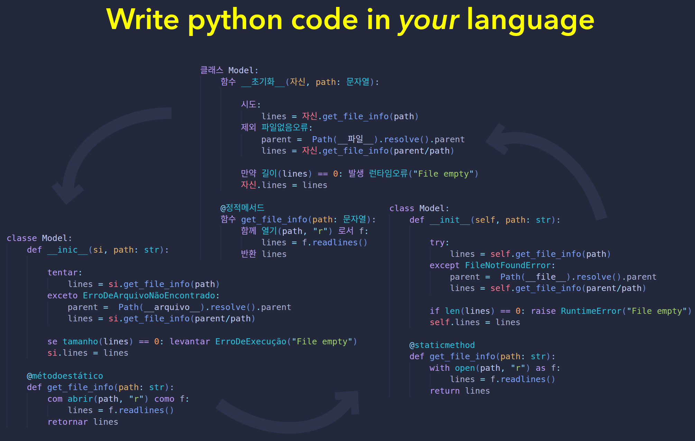

.. _en_index:

Pylyglot: write and run python code on your native language
===========================================================

How come it's 2026 and I can't write code in my own language,
with accents and special characters?

Pylyglot is an extremely simple python package with no dependencies
(other than python itself) which allow you to write "python" code
with keywords from your language. It can be used for teaching,
learning, in serious projects or for fun. Running it is as simple as running: 

``python -m pylyglot your_pylyglot_file``

Pylyglot also handles importing modules from different languages gracefully,
allowing for multilingual projects. 

With the `Pylyglot VSCode extension <vscode>`_, 
**syntax highlighting is also available for all
supported languages**. The language is automatically recognized by the file extension: 
``.language_code.py`` (e.g. portuguese_module **.pt.py**).

Links:

- `Github repository <https://github.com/AntonioRochaAZ/pylyglot>`_
- `VSCode extension (marketplace) <https://marketplace.visualstudio.com/items?itemName=AntonioRochaAZ.pylyglot>`_
- `VSCode extension (source) <https://marketplace.visualstudio.com/items?itemName=AntonioRochaAZ.pylyglot>`_
- `PyPI page <https://pypi.org/project/pylyglot/>`_

.. toctree::
    :caption: Using pylyglot 
    :maxdepth: 1

    installation
    features
    work
    options
    languages
    security
    troubleshooting
    configs

.. toctree::
    :caption: Contributing
    :maxdepth: 1

    ai
    contributing
    supported_keywords
    contributors

.. toctree::
    :caption: Code
    :maxdepth: 1

    pylyglot/config
    pylyglot/console
    pylyglot/hooks
    pylyglot/translator
    pylyglot/utils

Indices and tables
==================

* :ref:`genindex`
* :ref:`modindex`
* :ref:`search`