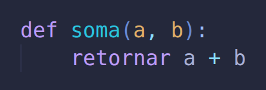

===============
Troubleshooting
===============

.. hint::
    The messages you received may have been in another language.

Variable printed/repr'd as its English counterpart
===================================================

For example, in a French console:

.. code-block:: python

    >>> imprimer(Faux) # print(False)
    False
    >>> imprimer(ErreurDeNom) # print(NameError)
    <class 'NameError'>

This is the desired behaviour. It would be possible to translate
the outputs shown on screen. However, this would make it so that
command line outputs from the same python file, written in different
languages, would be different, which wouldn't be desired and 
potentially misleading or more confusing than this behaviour already
is.

ImportError: cannot import name 'X' from 'Y'
============================================

Consider this function defined in a portuguese file
(``test.pt_br.py``):

When we try:

.. code-block:: python

    from test import soma

We get :

.. code-block:: text

    ImportError: cannot import name 'soma' from 'test' (.../test.pt_br.py)

"soma" is the name of the builtin "sum" in portuguese.
This portuguese file is replacing the builtin sum function
by a custom one (which is a completely valid thing to do
in python, this is a feature, not a bug).

However, this means that the function will be renamed to "sum" in the process
of translation, and thus have another name. In that case, we must do this instead:

.. code-block:: python

    from test import sum

.. tip::
    If you don't want to overwrite the builtin in the main code, you can import the function "as" another name:

    .. code-block:: python

        from test import sum as custom_sum

To find out the builtin name the function is translated to, you may want to
translate the file to regular python (or whatever the language you are writing
with) with the help of the :ref:`--translate option <translate_option>`
(the function will be defined at the same line number). 

.. todo::
    A more clear error message could be worked on in the future.
    A proper solution seems far-fetched (probably overly complicated for the scope of the project).

RuntimeError: The file being translated (...) contains the following words present in the destination language...
=================================================================================================================

The message gives more insight on the error, but I'd like to point you to :ref:`our dedicated security page <security_ref>`. 

ImportError: Error while finding module specification for 'X' (ImportError...)
==============================================================================

The message also gives clear insight on the error, this may happen when two files share
the same name but two different valid pylyglot file extensions (for example 
trying to run ``main.py``, when a file called ``main.pt.py`` is present in the same folder).

Although one could perhaps make this work for *running* ``main.py`` (since the file names are
in fact different), if we have a file in the same folder which tries to import ``main``,
then this error would still show up.

.. todo::
    Check if it is possible to solve this for running the file nevertheless?

SyntaxError: Invalid syntax/Pylyglot warning: SyntaxErrors may come from the use of python keywords in code
===========================================================================================================

This error may happen most unexpectedly when using the pylyglot console. It
happens when an English python keyword is used in a statement. For example
in a Portuguese console:

.. code-block:: python

    >>> for = 1

Because ``for`` is not a keyword in Portuguese python, this statement is kept
as is during translation, giving an expected ``SyntaxError``.